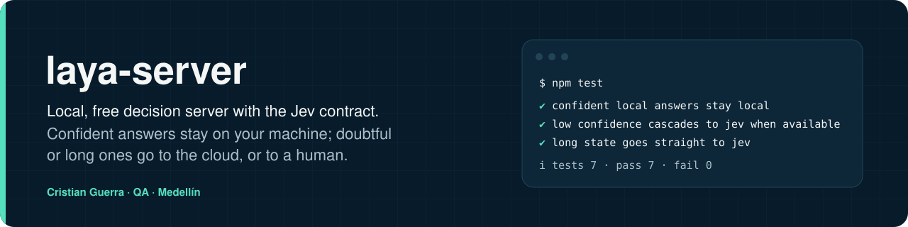
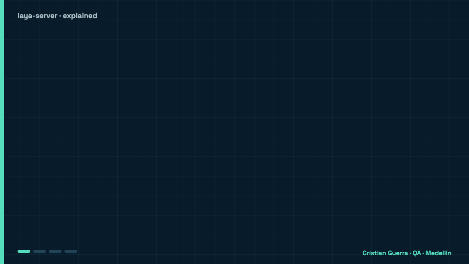
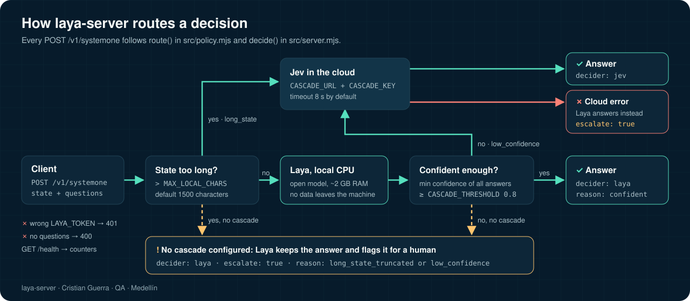

[Leer en español](README.es.md)



## Explained like you're 8

Cris has a video factory, ADN Generator, that makes videos. Before trusting a video, someone has to answer quick questions about it, like "does the start grab you?" or "are the comments good?". laya-server is a small judge that answers those short yes-or-no and pick-one questions for free, on Cris's own computer, called WAR. When a question is too long, or the judge is not sure, it asks a bigger judge in the cloud, called Jev. For now it works in **shadow mode**: its answers are written down so they can be compared later, but it never stops a video.

<p align="center">
  
</p>

### A real example

- **Imagine** the factory has a new video with a short opening line. It asks gate G2: "does this hook work?"
- **What happens:** the question is short (under 1,500 characters), so Laya answers on WAR, in well under a second and at no cost. If Laya is less than 80% sure, the question goes up to Jev.
- **Another question,** gate G3 "does the script fit the channel?", carries the channel's identity and the whole script. That is too long for Laya, which reads about 350 words, so it goes straight to Jev.
- **What we gain:** easy questions cost $0 and the data stays at home, hard ones still get a strong answer, and in shadow mode nothing breaks while Cris finds out whether Laya is good enough. Nobody has measured Laya's quality in Spanish yet: that measurement comes before trusting it.

Which question goes where (from [docs/ADN.md](docs/ADN.md)):

| Gate | The question, in plain words | Who answers |
|---|---|---|
| G1 | Do the words match the pictures? (long windows of 15 beats) | Jev |
| G2 | Does the start grab you? | Laya, Jev if Laya is unsure |
| G3 | Does the video fit the channel? | Jev |
| G4 | Final review gate, built from G2 and G3 | — |
| G5 | Do the hooks of the Shorts work? | mixed |
| G6 | Are the comments good? | Laya |

### Hard words

| Word | What it means |
|---|---|
| **Laya** | The small free "brain" that runs on Cris's computer, no internet needed. |
| **Jev** | A bigger judge in the cloud. It knows more, but each question costs money. |
| **Cascade** | Passing a hard question up to someone who knows more. |
| **Threshold 0.8** | How sure the small judge must be (8 out of 10) to answer alone. |
| **Shadow mode** | Practice mode: answers are written down, but they don't change anything. |
| **Gate** | A checkpoint question every video goes through. |
| **Tailscale** | A private tunnel, so only Cris's own machines can talk to the server. |

## What it is

Local, free, Jev-compatible decision server. It runs [Laya](https://huggingface.co/convaiinnovations/laya) (open System One model, Apache-2.0, ~2 GB RAM, CPU only) behind the same `POST /v1/systemone` contract as TypeSafe Jev, with an optional **cascade**: confident answers stay local, uncertain or long inputs go to Jev in the cloud, and if the cloud fails the answer comes back flagged `escalate: true` for a human.

## How it works




The routing rule is `route()` in [`src/policy.mjs`](src/policy.mjs); the server in [`src/server.mjs`](src/server.mjs) calls it before and after asking Laya. Without `CASCADE_URL` and `CASCADE_KEY`, whatever would go to Jev stays in Laya with `escalate: true`.

## Why
- Free and unlimited locally, ~0.1–0.6 s per call on CPU, data never leaves the machine.
- Laya reads at most 512 tokens of state (~350 words) and prefers < 20 options: good for short messages (WhatsApp, tickets, titles), not long documents. Longer states go straight to the cascade.
- Quality in Spanish is not published by the model authors: measure it on your own labelled set before trusting thresholds.

## Run
```sh
npm install
node --env-file=.env src/server.mjs   # Node ≥ 20.6
```
| Env | Default | |
|---|---|---|
| `PORT` / `HOST` | `8787` / `0.0.0.0` | |
| `LAYA_TOKEN` | empty | Bearer token required by clients if set |
| `CASCADE_URL` / `CASCADE_KEY` | empty | Jev endpoint + key; empty = local only |
| `CASCADE_THRESHOLD` | `0.8` | minimum confidence to keep a local answer |
| `MAX_LOCAL_CHARS` | `1500` | longer states skip Laya |
| `CASCADE_TIMEOUT_MS` | `8000` | timeout of the call to Jev |

Response: `{ model, decider: "laya"|"jev", reason, escalate, answers, usage, ms }`. `GET /health` returns counters.

## Test

```sh
npm test
```

Seven `node:test` cases cover the routing policy: confidence of yes/no and choice answers, confident answers staying local, low confidence going to Jev or to a human, long states skipping Laya, and normalizing the cloud's boolean answers. They do not load the model.

## Windows (one command, PowerShell as admin)
```powershell
irm https://raw.githubusercontent.com/criguex/laya-server/main/windows/Install-Laya.ps1 -OutFile $env:TEMP\i.ps1; & $env:TEMP\i.ps1 -CascadeKey "<optional Jev/AI Gateway key>"
```
Installs Node LTS if missing, the server in `C:\gwar\laya-server`, a logon task with auto-restart, and a firewall rule that only accepts the Tailscale range (100.64.0.0/10).

## Author

Cristian Guerra · QA · Medellín · [github.com/criguex](https://github.com/criguex)

MIT. Laya weights by Convai Innovations under Apache 2.0.
